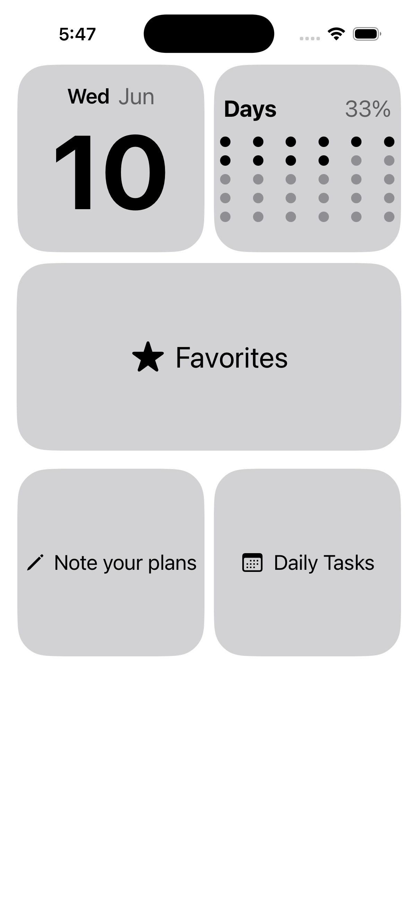
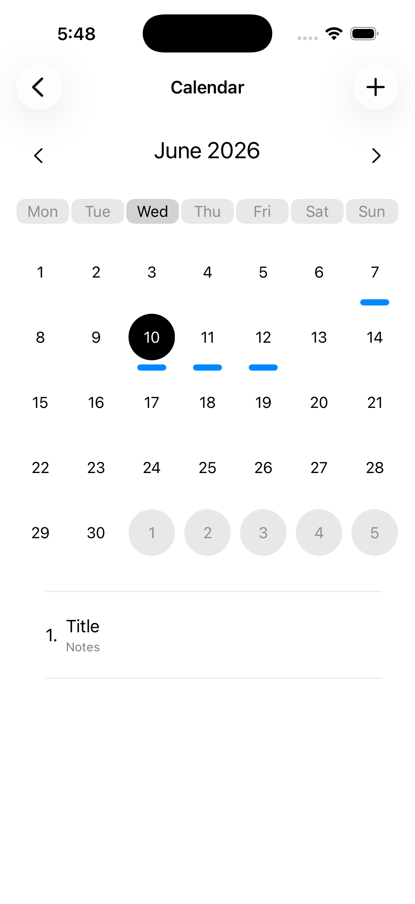
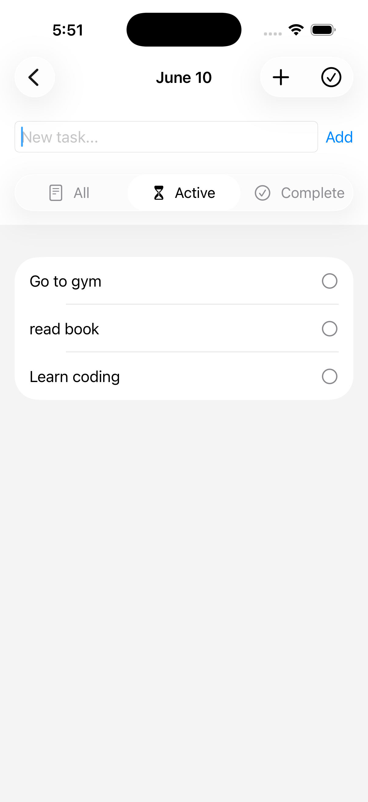
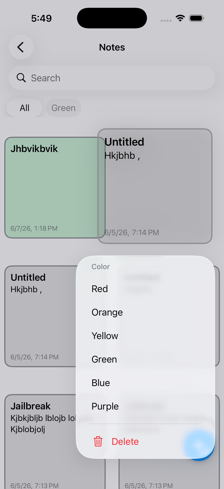

# NewToDoApp

A SwiftUI productivity app that combines daily tasks, quick notes, and calendar planning in one local-first app.

This project was built to practice SwiftUI app architecture, SwiftData persistence, MVVM, Combine, and custom UI components.

## Screenshots

<p align="center">
  
  
  
  
</p>

## Features

### Home

* Quick access to tasks, favorite tasks, notes, and the calendar
* Today's date and monthly progress summary
* Refresh the date and monthly progress at midnight and when returning to the app
* Adaptive card layout with system colors for light and dark mode

### Tasks

* Add new daily tasks
* Mark tasks as completed
* Filter tasks by All / Active / Completed
* Mark tasks as favorites
* Delete selected tasks
* View favorite tasks on a separate screen
* Horizontal paging between task tabs

### Notes

* Create and edit notes
* Save notes locally with SwiftData
* Search notes by title or content
* Debounced search using Combine
* Assign notes to color categories
* Filter notes by category
* Rename categories
* Delete notes from context menu

### Calendar

* Custom monthly calendar UI
* Create calendar plans
* Edit existing plans
* Delete plans
* Show plans for selected date
* Validate empty title and invalid date range
* Store calendar plans locally with SwiftData
* Match the calendar grid to the system's first weekday
* Open new plans on the selected date with a default 09:00–10:00 time range
* Keep the editor open with entered details when saving fails
* Show loading errors with a retry option

## Tech Stack

* Swift
* SwiftUI
* SwiftData
* Combine
* MVVM
* Swift Concurrency
* Swift Testing
* Xcode

## Architecture

The app uses MVVM, with source files grouped by feature. SwiftUI views display state and handle user interaction; `@MainActor` ViewModels expose `@Published` state, validate input, and perform SwiftData operations.

The main source and test layout is:

```text
.
├── ToDo.xcodeproj
├── ToDo.xctestplan
├── ToDoApp
│   ├── ToDoApp.swift               # App startup, ReadyAppView, dependency setup
│   ├── ContentView.swift           # Home navigation and feature cards
│   ├── HomeCalendarSummaryView.swift # DataDayView: date and month summary
│   ├── ToDo
│   │   ├── Model
│   │   │   ├── ModelTask.swift
│   │   │   └── TabModel.swift
│   │   ├── View
│   │   │   ├── TaskListView.swift
│   │   │   ├── TaskPageView.swift
│   │   │   ├── CustomTabView.swift
│   │   │   └── FavoriteView.swift
│   │   └── ViewModel
│   │       └── TaskViewModel.swift
│   ├── Note
│   │   ├── Model
│   │   │   ├── ModelNote.swift
│   │   │   └── NoteCategory.swift
│   │   ├── Views
│   │   │   ├── QuickNote.swift
│   │   │   ├── NotePageView.swift
│   │   │   ├── NoteRow.swift
│   │   │   ├── NoteEditorView.swift
│   │   │   └── Components
│   │   │       ├── NoteCategoryMenu.swift
│   │   │       └── NoteCategoryPagerView.swift
│   │   └── ViewModel
│   │       └── NoteViewModel.swift
│   ├── CalendarService
│   │   ├── Model
│   │   │   ├── CalendarPlan.swift
│   │   │   └── CalendarManager.swift
│   │   ├── Views
│   │   │   ├── CustomCalendarView.swift
│   │   │   ├── CalendarHeaderView.swift
│   │   │   ├── CalendarPlanListView.swift
│   │   │   └── CalendarPlanEditorView.swift
│   │   └── ViewModel
│   │       └── CalendarPlanViewModel.swift
│   └── Shared
│       ├── PersistenceController.swift
│       ├── CalendarService.swift
│       └── TabPagingModifiers.swift
└── ToDoTests
    └── ToDoTests.swift
```

**Startup and dependencies.** `ToDoApp` asks `PersistenceController` to create a `ModelContainer` for `ModelTask`, `ModelNote`, `NoteCategory`, and `CalendarPlan`. If opening the store fails, the app shows an error and a Retry action. Once the container is ready, `ReadyAppView` owns the three feature ViewModels using `@StateObject`, passes `container.mainContext` into their initializers, and supplies them to child views using `environmentObject`. The container is also attached to the view hierarchy with `modelContainer`.

**Persistence and updates.** The ViewModels fetch data through their injected context and publish arrays for the views to observe. Write operations create a separate context from the same container with autosave disabled. They find existing records by UUID where needed, explicitly save the changes, and then reload the displayed data. Write errors are thrown to the calling view; loading errors are published as state.

**Notes and search.** `NoteViewModel` uses Combine to debounce search input. It filters notes by category and by text in their titles or content. `NoteCategory` stores category data; the `NoteCategoryColor` helper currently lives in the same model file.

**Calendar and Home.** The `CalendarService` folder contains the calendar feature. Its `CalendarManager` struct builds the month grid and handles date navigation, while `CalendarPlanViewModel` manages saved events. Separately, the `CalendarService` actor in `Shared/CalendarService.swift` calculates the Home summary and next midnight. `DataDayView` calls this actor from a SwiftUI task and refreshes its local state when the app becomes active and at midnight.

## Testing

The `ToDoTests` target contains eight tests written with Swift Testing:

* Calculating the next midnight across a year boundary
* Rejecting a task with a blank title
* Persisting a newly added task
* Searching note titles and content regardless of letter case or surrounding whitespace
* Reusing an existing category when assigning the same color to multiple notes
* Rejecting a calendar event whose end precedes its start
* Keeping an existing task when a batch deletion includes a missing task
* Reading a saved task after reopening a file-backed SwiftData container

Tests use their own SwiftData containers. The persistence test creates a temporary store and removes it afterward. The `ToDo` test plan also sets `TODO_TESTING=1`, which makes the host app use an in-memory store during tests.

To run the suite, open `ToDo.xcodeproj`, select the `ToDo` scheme and a compatible iOS simulator, then choose **Product → Test** (`⌘U`). The app targets iOS 26.4 or later; the test target currently requires iOS 27.2 or later.

## What I Learned

While building this project, I practiced:

* Connecting SwiftData with ViewModels
* Building CRUD features with local persistence
* Separating UI logic from data logic
* Using `@MainActor` with ObservableObject ViewModels
* Using Combine for debounced search
* Creating reusable SwiftUI views
* Building a custom calendar grid
* Handling validation errors in a ViewModel
* Managing app state across multiple screens
* Writing Swift Testing assertions with `#expect` and unwrapping values with `#require`
* Isolating test data with in-memory containers and temporary stores
* Injecting a calendar and reference dates for predictable date calculations

## Project Status

This is a personal learning project focused on improving SwiftUI, SwiftData, MVVM, Combine, and app architecture skills.

The project is still being improved and refactored.

## Future Improvements

### Original plan — June 10, 2026

This list was added in commit [`71800c9`](https://github.com/Boburbek0109/NewToDoApp/commit/71800c93dd8718b85ec0356a9d488827650bd8b6). It is preserved here to show the original goals.

* Add unit tests for ViewModels
* Improve error handling with user-facing alerts
* Refactor repeated home card UI into reusable components
* Move color mapping out of model files
* Improve dark mode styling
* Add better empty states
* Add App Store-ready app icon and launch screen
* Improve README screenshots and demo GIF

### Progress update — November 6, 2026

Completed from the original plan:

* Added eight tests covering ViewModel behavior, date calculations, and SwiftData persistence.
* Added user-facing save and delete errors, loading error messages, and retry actions across tasks, notes, and the calendar.
* Added empty states for task lists, favorites, notes, note search results, and calendar plans.

Partially completed:

* Improved dark mode styling on Home with system backgrounds and adaptive text colors.
* Added four screenshots to the README and removed the screenshot placeholder. The images still need to be refreshed for the current UI, and a demo GIF remains planned.

Other improvements completed by this update:

* Updated the Home layout and added date and monthly progress refreshes at midnight and on app activation.
* Improved calendar month navigation, weekday ordering, event date defaults, and save error handling.
* Isolated the test host from the app's persistent store and added a temporary-store persistence test.

Still planned:

* Extract repeated Home card UI into reusable components.
* Move color mapping out of model files.
* Continue reviewing dark mode styling beyond Home.
* Add an App Store-ready app icon and launch screen.
* Refresh the screenshots and add a demo GIF.

## Acknowledgements

During development, I used documentation, articles, tutorials, and code review feedback to better understand SwiftUI, SwiftData, MVVM, Combine, and app architecture.

Helpful resources:
- SwiftData + MVVM article: https://medium.com/@darrenthiores/the-ultimate-guide-to-swiftdata-in-mvvm-achieves-separation-of-concerns-12305f9e82d1
- https://www.hackingwithswift.com/quick-start/swiftdata/how-to-use-mvvm-to-separate-swiftdata-from-your-views
- https://www.youtube.com/@seanallen
- https://www.youtube.com/@SwiftfulThinking
- https://stackoverflow.com/questions/76493800/swift-ui-calendar-without-packages
- https://github.com/HappyIosDeveloper/SwiftUI-TagView/blob/main/README.md
- https://github.com/zinkxx/devnotes/blob/main/README.md
- AI tools were also used as a learning assistant for debugging, code review, and understanding Swift concepts.
